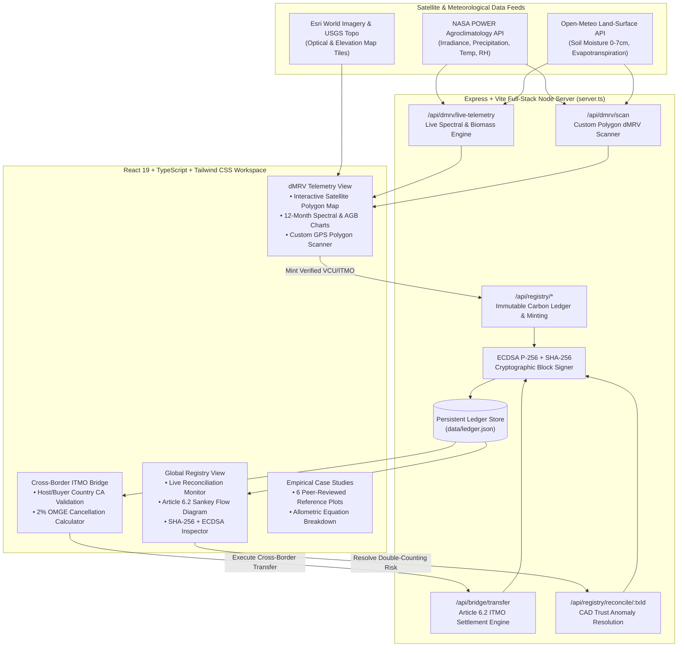
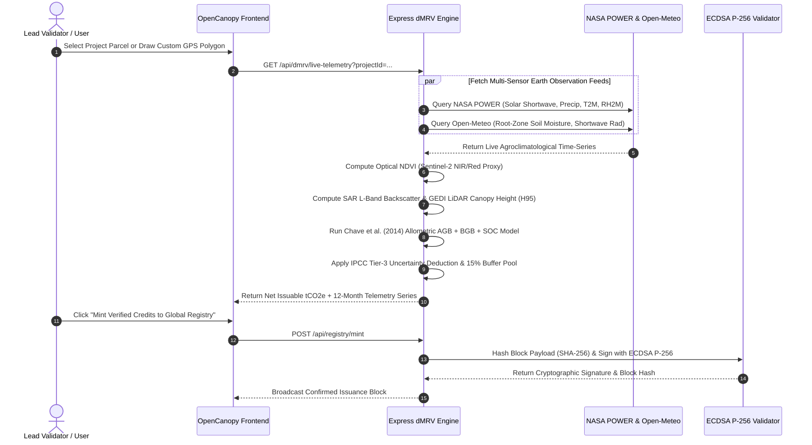
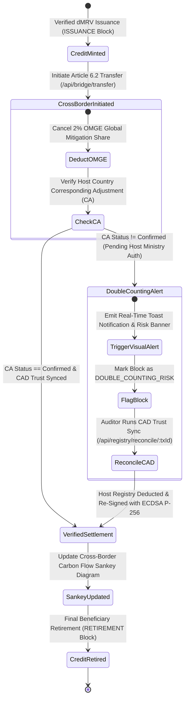

# OpenCanopy — Satellite dMRV & Article 6.2 Carbon Registry Protocol

**OpenCanopy** is a full-stack Digital Measurement, Reporting, and Verification (**dMRV**) platform and **Paris Agreement Article 6.2 Cross-Border Carbon Ledger**. It combines live multi-spectral satellite telemetry (NASA POWER agroclimatology & Open-Meteo soil/radiation feeds), allometric above-ground biomass (AGB) modeling, ECDSA P-256 cryptographic block signing, and an interactive global registry with real-time double-counting anomaly detection.

---

## Key Capabilities

- **Live Multi-Sensor Satellite dMRV Engine**
  - Pulls live solar irradiance (`ALLSKY_SFC_SW_DWN`), precipitation (`PRECTOTCORR`), temperature (`T2M`), relative humidity (`RH2M`), and root-zone soil moisture from **NASA POWER** and **Open-Meteo** APIs for real GPS project polygons.
  - Computes **NDVI** (Sentinel-2 L2A Band 8 NIR / Band 4 Red), **SAR L-Band Backscatter** ($\gamma^0$ dB), **GEDI LiDAR Canopy Height** ($H_{95}$), **Above-Ground Biomass (AGB)** via Chave et al. (2014) pantropical allometry, and **IPCC Tier-3 Uncertainty Monte Carlo bounds**.
- **Cryptographically Signed Registry Ledger**
  - Every carbon credit issuance, cross-border transfer, and retirement is hashed with **SHA-256** and signed using an **ECDSA P-256** validator keypair (`SHA-256 + ECDSA-P256`), forming an immutable hash-linked block chain with public-key signature verification.
- **Paris Agreement Article 6.2 Cross-Border ITMO Bridge**
  - Executes Internationally Transferred Mitigation Outcome (**ITMO**) settlements across national registries (**Verra**, **Gold Standard**, **ICR**, **ACR**, **CAR**, **ART-TREES**, and **UNFCCC CAD Trust**).
  - Enforces **Corresponding Adjustments (CA)** between host exporting nations and acquiring nations, plus automated **2% OMGE (Overall Mitigation in Global Emissions)** cancellation.
  - Visualizes real-time cross-border carbon volume movements using an interactive **Recharts Sankey Diagram**.
- **Real-Time Transaction Reconciliation & Anomaly Detection**
  - Continuously audits ledger blocks against national registry balances and CAD Trust synchronization states.
  - Triggers immediate visual toast alerts and persistent reconciliation diagnostics for **Double-Counting Risks** (unconfirmed Corresponding Adjustments), **Cryptographic Chain Mismatches**, and **Pending CAD Trust Sync** anomalies, with one-click automated CAD Trust resolution.
- **Interactive Satellite Telemetry Map & Empirical Field Case Studies**
  - Interactive Leaflet + Esri World Imagery / USGS Topographic map with parcel polygon overlays, 12-month time-series spectral profiling, and 6 peer-reviewed empirical field case studies across South Asia, Southeast Asia, Amazonia, and Sub-Saharan Africa.

---

## System Architecture (Mermaid)



---

## Satellite dMRV & Allometric Biomass Pipeline



---

## Article 6.2 Cross-Border ITMO & Anomaly Reconciliation Flow



---

## Scientific & Biophysical Methodology

1. **Above-Ground Biomass (AGB)** — *Chave et al. (2014) Pantropical Allometric Model*:
   $$\text{AGB}_{\text{tree}} = 0.0673 \times \left(\rho \cdot D^2 \cdot H\right)^{0.976}$$
   where $\rho$ is species-specific wood density ($\text{g/cm}^3$), $D$ is diameter at breast height ($\text{cm}$), and $H$ is GEDI LiDAR 95th-percentile canopy height ($\text{m}$).
2. **Below-Ground Biomass (BGB)** — *IPCC Tier-2 Root-to-Shoot Ratio ($R_{\text{rs}}$)*:
   $$\text{BGB} = \text{AGB} \times R_{\text{rs}} \quad \text{(e.g., } R_{\text{rs}} = 0.42 \text{ for tropical mangroves, } 0.24 \text{ for rainforests)}$$
3. **Total Carbon Stock & $\text{CO}_2\text{e}$ Conversion**:
   $$\text{Total }\text{tCO}_2\text{e/ha} = \left[(\text{AGB} + \text{BGB}) \times 0.47 + \text{SOC}_{0\text{–}30\text{cm}}\right] \times \frac{44}{12}$$
4. **Conservative Issuance Deduction**:
   $$\text{Issuable Credits} = \text{Gross }\Delta\text{tCO}_2\text{e} \times (1 - U_{\text{95\% CI}}) \times (1 - B_{\text{pool}}) - L_{\text{belt}}$$
   where $U_{\text{95\% CI}}$ is the Monte Carlo 95% confidence interval deduction, $B_{\text{pool}} = 15\%$ is the permanence buffer pool contribution, and $L_{\text{belt}}$ is surrounding 5 km leakage belt displacement.

---

## Project Structure

```text
openCanopy/
├── server.ts                              # Express + Vite full-stack server, live satellite APIs & ECDSA ledger
├── src/
│   ├── App.tsx                            # Main navigation shell, ledger sync & verification modal
│   ├── types.ts                           # Shared TypeScript interfaces for blocks, projects & telemetry
│   ├── data/
│   │   └── mockData.ts                    # Initial verified project baselines & empirical field case studies
│   ├── utils/
│   │   └── dmrvEngine.ts                  # Biophysical allometry, deterministic SHA-256 & ledger verifier
│   └── components/
│       ├── GlobalRegistryView.tsx         # Registry ledger, Sankey diagram & real-time anomaly alerts
│       ├── DmrvTelemetryView.tsx          # Multi-sensor telemetry dashboard & custom polygon scanner
│       ├── InteractiveSatelliteMap.tsx    # Leaflet satellite/topo map with interactive GPS polygons
│       ├── CrossBorderBridgeView.tsx      # Paris Agreement Article 6.2 ITMO settlement bridge
│       └── CaseStudiesView.tsx            # Peer-reviewed empirical forest carbon case studies
├── data/
│   └── ledger.json                        # Persistent hash-linked carbon registry blocks
└── package.json
```

---

## Local Development & Quick Start

### Prerequisites
- **Node.js** v20+ and **npm**

### Installation & Running

```bash
# 1. Install dependencies
npm install

# 2. Start the full-stack Express + Vite server on port 3000
npm run dev
```

Open **`http://localhost:3000`** in your browser.

### Production Build & Verification

```bash
# Type-check with TypeScript
npm run lint

# Build production client bundle to dist/
npm run build
```

---

## Security & Cryptographic Notes

- On first boot, `server.ts` generates a local **ECDSA P-256** validator keypair at `data/validator-key.json` (automatically ignored by `.gitignore` so private keys are never committed to version control).
- Every block in `/api/registry/state` includes its `blockHash`, `previousHash`, `signature`, `signerPublicKey`, and live `cryptoVerified` status.
